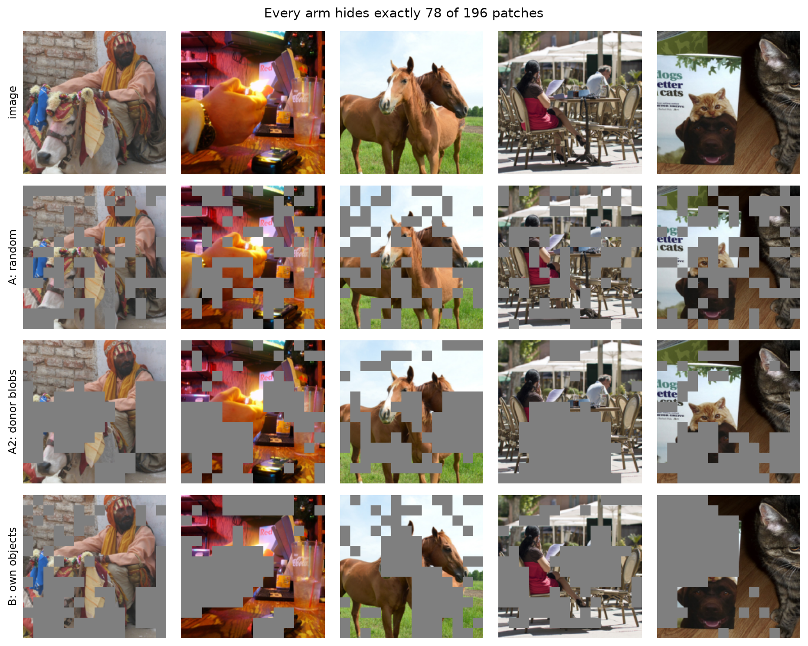
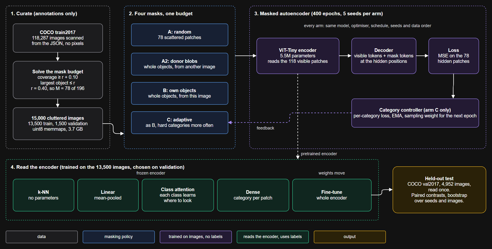
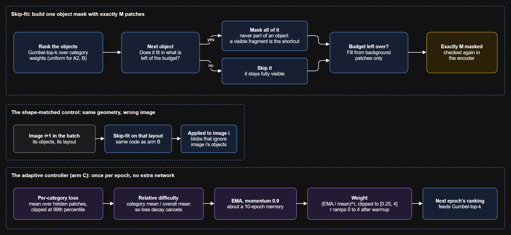
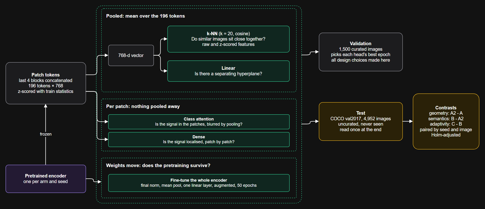
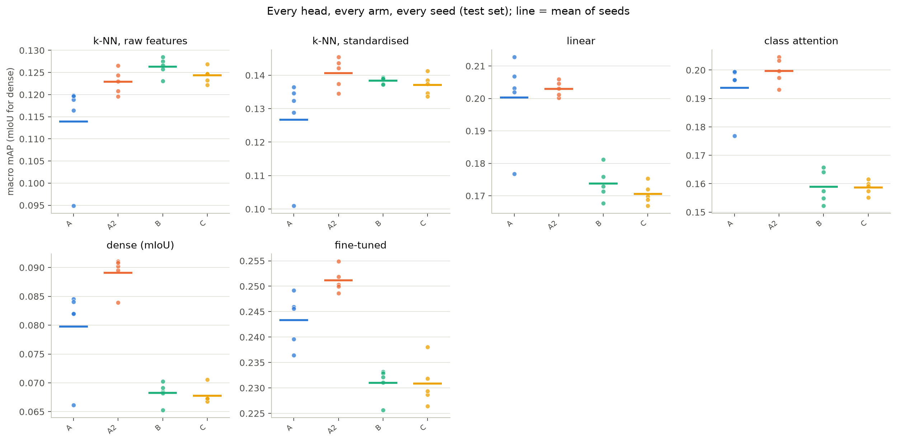
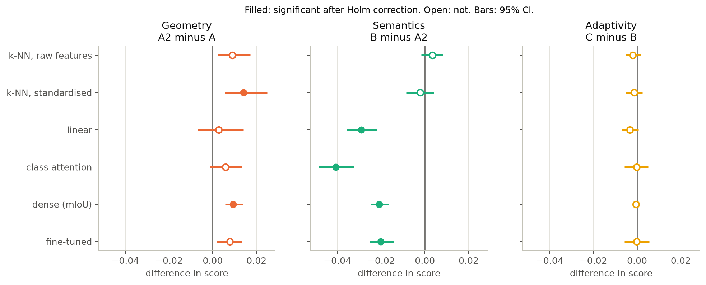
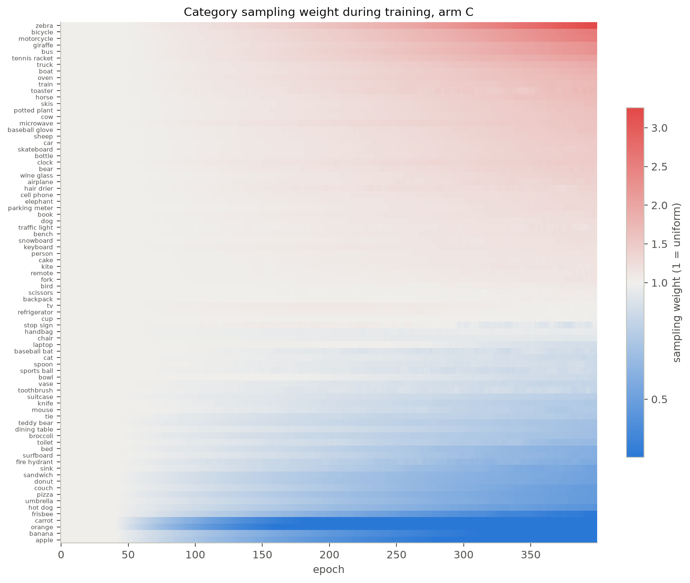
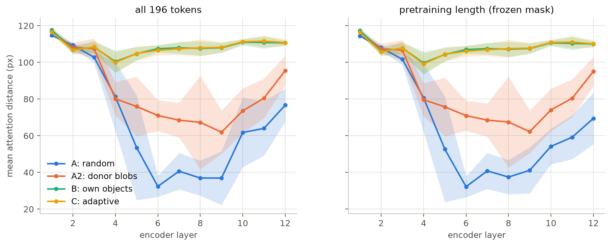
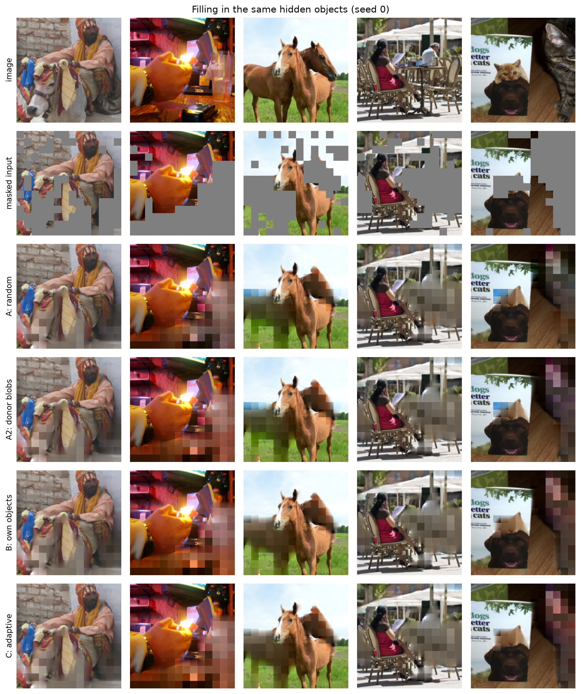
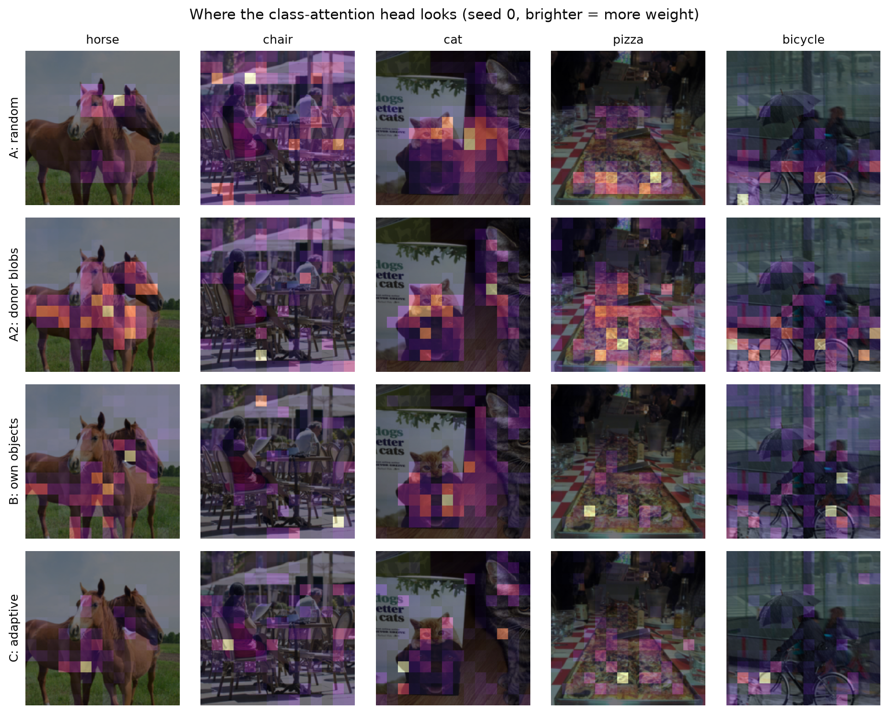

# ShapeMAE

A masked autoencoder learns by hiding parts of an image and filling them back in. Hiding whole objects sounds better
than hiding random patches, but it changes two things at once: the **shape** of the holes and **what** is under them.
ShapeMAE separates the two with a control arm that borrows its mask from another image: object-shaped holes that
ignore the objects actually in the picture.

Four arms hide exactly the same number of patches, and five different heads then test what each encoder learned. The
result was not the one the idea predicts: **object-shaped holes help a little, but placing them on the real objects
makes the features worse.**

This project grew out of a capstone with Kartika Dhonde, Shlok Doshi and Kshitij Jhalak, guided by Hiral Modi.



## How it works



(Editable source: [docs/architecture.drawio](docs/architecture.drawio), opens in [draw.io](https://app.diagrams.net).
It has three pages; the other two are shown below.)

**Curation.** Whole-object masking only makes sense when objects can fill the mask. The budget is solved from the
annotations: for a ratio r, objects must cover at least r + 0.10 of an image and the largest object must be at most r.
r = 0.40 is the highest ratio that leaves 15,000 images, so every arm hides **M = 78 of 196 patches**. The 15,000 images
split into 13,500 for training and 1,500 for validation. The 4,952 images of COCO val2017 are the test set, uncurated.

**Four arms.** Same model, optimiser, schedule, seeds and budget. Only the mask differs, and each contrast moves one
variable.

| Arm | Mask | What changes from the arm before |
|---|---|---|
| A: random | 78 scattered patches | baseline |
| A2: shuffled | whole objects of the next image in the batch, applied to this image | scattered holes become object-shaped blobs, with no link to this image |
| B: instance | whole objects of this image | the blobs now sit on this image's real objects |
| C: adaptive | as B, but categories that are hard to reconstruct are picked more often | uniform category choice becomes difficulty-weighted |

**Building an object mask.** Objects are ranked by Gumbel-top-k and added whole if they fit in the remaining budget.
An object is never partly hidden, because a visible fragment is a shortcut. Any budget left over is filled from
background patches, and the encoder checks that exactly M patches are hidden.



**The model.** ViT-Tiny/16 at 224 px: 12 blocks, width 192, 5.5M encoder parameters. A 4-block decoder of width 128
brings the total to 6.4M. The loss is MSE on normalised pixels over the hidden patches.

**Five heads.** Each one reads an encoder in a different way. All train on the 13,500 images with labels, and the
trained heads pick their best epoch on validation.



| Head | Encoder | Question | Metric |
|---|---|---|---|
| k-NN (k = 20, cosine) | frozen | Do similar images sit close together? | macro mAP |
| Linear | frozen | Can the 80 categories be separated by a hyperplane? | macro mAP |
| Class attention | frozen | Is information in the patches being blurred by mean pooling? | macro mAP |
| Dense | frozen | Does each patch know its category? | mean IoU |
| Fine-tune | trainable | Does a difference survive once the weights can move? | macro mAP |

k-NN runs twice, on raw and on z-scored features, because the linear head always gets z-scored features.

### Where things are

| File | What it does |
|---|---|
| `configs/` | `base.yaml` plus one small file per arm |
| `src/config.py` | typed configuration, including all head settings |
| `src/data/download_subset.py` | curates from the annotations and solves the mask budget |
| `src/data/build_cache.py` | bakes images and instance maps into uint8 memmaps |
| `src/masking/strategies.py` | the four masks, skip-fit and the donor swap |
| `src/masking/adaptive.py` | the category controller for arm C |
| `src/models/mae.py` | the masked autoencoder; the mask is an input |
| `src/models/heads.py` | class attention and dense heads |
| `src/engine/train.py` | pretraining, shared by all arms, with crash-safe checkpoints |
| `src/engine/evaluate.py` | reconstruction, attention distance, treatment check |
| `src/engine/heads.py` | k-NN, linear, class attention, dense |
| `src/engine/finetune.py` | end-to-end fine-tuning |
| `src/engine/stats.py`, `analyze.py` | metrics, bootstrap, Holm correction, result tables |
| `src/utils/viz.py` | every figure in `results/figures/` |
| `scripts/run_all.py` | runs the whole experiment; safe to stop and restart |
| `results/` | the tables and figures behind this page |

## Results

Five seeds per arm, 20 encoders, 400 epochs each. All settings were fixed before the test set was read, and it was read
once. Every result is reported, including the nulls.

**Did the arms do what they were built to do?** Yes. Measured on identical images, instance masks hide objects whole and
the donor masks mostly do not:

| Mask | Objects fully hidden | Objects partly hidden | Objects fully visible | Hidden patches on objects |
|---|---|---|---|---|
| random | 7.9% | 77.8% | 14.3% | 64.5% |
| shuffled | 15.0% | 59.0% | 26.0% | 66.9% |
| instance | 70.8% | 0.5% | 28.7% | 84.7% |

The donor mask does not remove all alignment: it fully hides about twice as many objects as random does, probably
because objects in different images tend to sit in similar places.

**Table 1. Test set, mean ± standard deviation over 5 seeds.** Macro mAP, except dense (mIoU). Bold marks the best arm.

| Arm | k-NN raw | k-NN z-scored | Linear | Class attention | Dense | Fine-tune |
|---|---|---|---|---|---|---|
| A: random | .114 ± .011 | .127 ± .015 | .200 ± .014 | .194 ± .010 | .080 ± .008 | .243 ± .005 |
| A2: shuffled | .123 ± .003 | **.141** ± .005 | **.203** ± .002 | **.200** ± .005 | **.089** ± .003 | **.251** ± .002 |
| B: instance | **.126** ± .002 | .138 ± .001 | .174 ± .005 | .159 ± .006 | .068 ± .002 | .231 ± .003 |
| C: adaptive | .124 ± .002 | .137 ± .003 | .171 ± .003 | .159 ± .003 | .068 ± .002 | .231 ± .005 |



**Table 2. Paired contrasts on the test set.** Difference in score, 95% CI from a bootstrap over seeds and images, and
how many of the 5 seeds went the same way as the mean. p is Holm-adjusted across all 18 tests. With 1,000 bootstrap
samples the smallest possible adjusted p is .036.

| Head | Geometry (A2 - A) | Holm p | Semantics (B - A2) | Holm p | Adaptivity (C - B) | Holm p |
|---|---|---|---|---|---|---|
| k-NN raw | +.009 [.002, .017] 5/5 | .072 | +.003 [-.002, .008] 4/5 | 1.0 | -.002 [-.005, .002] 4/5 | 1.0 |
| k-NN z-scored | **+.014** [.006, .025] 5/5 | **.036** | -.002 [-.009, .004] 3/5 | 1.0 | -.001 [-.005, .002] 4/5 | 1.0 |
| Linear | +.003 [-.007, .014] 3/5 | 1.0 | **-.029** [-.036, -.022] 5/5 | **.036** | -.003 [-.007, .001] 4/5 | .96 |
| Class attention | +.006 [-.001, .013] 4/5 | 1.0 | **-.041** [-.049, -.033] 5/5 | **.036** | -.000 [-.006, .005] 3/5 | 1.0 |
| Dense | **+.009** [.006, .014] 5/5 | **.036** | **-.021** [-.025, -.016] 5/5 | **.036** | -.001 [-.002, .001] 3/5 | 1.0 |
| Fine-tune | +.008 [.002, .013] 5/5 | .176 | **-.020** [-.025, -.014] 5/5 | **.036** | -.000 [-.006, .006] 2/5 | 1.0 |



Instance minus random, the total effect of hiding real objects, is outside the corrected family: k-NN raw +.012,
k-NN z-scored +.012, linear -.027, class attention -.035, dense -.012, fine-tune -.012. Full values are in
[results/contrasts.csv](results/contrasts.csv).

**Table 3. Validation (1,500 curated images), means over 5 seeds.** The test images are not curated, so this checks
whether the pattern depends on that. Validation also picked each head's best epoch, so these scores run slightly high.

| Arm | k-NN raw | k-NN z-scored | Linear | Class attention | Dense | Fine-tune |
|---|---|---|---|---|---|---|
| A: random | .184 | .213 | .295 | .288 | .097 | .338 |
| A2: shuffled | .196 | .228 | .300 | .296 | .113 | .345 |
| B: instance | .191 | .225 | .266 | .247 | .088 | .332 |
| C: adaptive | .193 | .226 | .262 | .245 | .087 | .330 |

### What the results mean

**Real objects hurt.** B is significantly below A2 on four of the six measures and in all 5 seeds on each of them. The
gap survives fine-tuning, and it appears on curated validation images too, so it is not caused by the test set being
uncurated. On k-NN the two are level, so there is no measure where real objects helped.

**Geometry helps a little.** A2 is above A on all six measures, significantly on two after correction. Two more are
positive in all 5 seeds but do not survive the correction. Part of this gap comes from one weak run: random seed 0
scored .177 on linear against .202 to .213 for the other four. Its settings match the others and it was kept. Without
it, A2 minus A stays positive on five measures but shrinks (k-NN z-scored +.009, dense +.007, fine-tune +.006), and
linear moves to -.002. Semantics contrasts do not involve arm A, so this seed cannot affect them.

**Adaptivity does nothing measurable.** The controller works as designed. Its policy is close to identical across
seeds: zebra ends at weight 3.26 ± .02, and apple, banana, carrot and orange all sit at the 0.25 floor. It changes no
head score (all six adjusted p ≥ .96), and the spread of difficulty across categories does not shrink (CV .176 against
.177 for arm B).



**Better reconstruction did not mean better features.** B and C have the lowest error on object masks (.646, against
.676 for A) and the weakest scores on linear, class attention, dense and fine-tuning.



**The masks produce different attention patterns.** Random drops to about 32 to 41 px in layers 6 to 9 and shuffled to
about 62 to 71 px, while instance and adaptive stay at 100 px or more in every layer. So object masks do force long-range
attention, but here that did not lead to better features. Random varies most between seeds.

**Why might real objects hurt?** This was not tested, so treat these as hypotheses. Instance masks put 85% of hidden
patches on objects against 65% for random, so the encoder sees mostly background during pretraining and then has to
describe objects at test time. Reconstructing a fully hidden object from its surroundings is also badly under-determined,
which may reward context over object detail. Figure F2 shows all arms producing similar blurry fills on the same hidden
objects.



**Heads compared.** Fine-tuning is the strongest head for every arm. Class attention never beat linear: it scored
.003 to .015 lower on the test set. Its attention over patches overfits 13,500 images quickly, and with attention held
uniform it only matches linear (seed 0, validation). So mean pooling is not hiding usable information at this scale.
Z-scoring raises k-NN by .012 to .018 in every arm, so raw k-NN and a z-scored linear head are not a fair pair. The
conclusions above do not depend on which k-NN is used, though the raw version loses significance for geometry.



## Design decisions

- **A donor mask as the control.** Instance against random changes shape and placement together. Borrowing the next
  image's objects keeps the shape statistics and breaks the placement, using the same code path as arm B.
- **Equal budget, enforced in code.** Every arm hides exactly 78 patches. A difference in mask ratio would change task
  difficulty and explain any result on its own.
- **40% masking, not 75%.** At 75%, objects would need to cover 85% of an image and only 2,788 images qualify. 40% is the
  highest ratio that leaves 15,000 images.
- **Whole objects only.** Partly hiding an object leaves a fragment to copy from, which is the shortcut this design
  removes. Objects that do not fit are skipped and stay visible.
- **Epoch-level, relative difficulty for arm C.** Per-step updates would favour rare categories for being rare. Dividing
  by the overall mean cancels the general fall in loss. Clipping weights to [0.25, 4] stops one category taking over.
- **Five heads, because one can mislead.** Linear and k-NN measure different things, and frozen scores may not survive
  fine-tuning.
- **A held-out test set that was read once.** All choices were made on validation. The test set is uncurated, so it
  also shows how the features do on ordinary images.
- **Seed and image bootstrap.** Resampling only images would ignore training noise, which random seed 0 shows is real.
- **Built for a 6 GB laptop GPU.** bf16, batch size 128, fused AdamW and mask building overlapped with GPU work keep a
  run at about 1h50m and 2.3 GB of VRAM. Checkpoints are written atomically every 10 epochs, and a forced kill of the
  whole process tree resumed cleanly.

**How settings were chosen.** All on validation:

- Pretraining learning rate: arm B only, seed 0, 200 epochs. An effective rate of 1.2e-3 beat 7.5e-5 on linear
  (.220 against .177). A third value, 6e-4, was stopped by a crash and not rerun.
- Length: 400 epochs beat 200 on arm B (linear .252 against .220, same head settings), so all arms ran 400.
- Frozen head learning rates: seed 0, arms A and B.
- Fine-tuning learning rate: seed 0, arm B, two values.

Tuning on arm B could favour it, and it still came out behind. For scale, an untrained encoder scores .123 on validation
linear with the same head settings as the .252 above.

## Limitations

- **Small scale.** ViT-Tiny and 13,500 images. Absolute scores are low, and the conclusions may not hold for larger
  models or more data.
- **One dataset, one budget.** Only COCO and 40% masking were tested. 40% is also a gentle setting for random masking, so
  nothing here compares against standard MAE at 75%.
- **No training from scratch.** Fine-tuning was not compared against a randomly initialised encoder, so the table shows
  differences between arms, not the total value of pretraining.
- **Curated pretraining data.** All arms train on cluttered images that favour object masking, yet it still lost.
- **The control is imperfect.** Donor masks keep some alignment with the real objects (see the treatment table).
- **Random has one weak seed,** which raises its variance and partly drives the geometry result.
- **Tuning was limited.** The learning rate was piloted on arm B only, with two completed values. Random seed 0's weak run
  may mean 1.2e-3 is near the edge of stable for that arm, which was not investigated.
- **Five seeds** can detect the large semantics gaps, but not small effects. A null here means no effect was found, not
  that the effect is exactly zero.
- **Causes are untested.** The explanations for why real objects hurt are hypotheses, not measurements.

## Setup and running

Needs Python 3.12 and an NVIDIA GPU with CUDA 12 drivers. Tested on Windows 11 with an RTX 4050 Laptop GPU (6 GB).

```powershell
py -3.12 -m venv .venv
.venv\Scripts\Activate.ps1
pip install -r requirements.txt
pytest
python scripts/smoke_test.py
```

The smoke test runs the whole pipeline on a tiny budget. All paths are relative to the repository root, so the folder
can be moved freely. Recreate `.venv` after a move. `data/` and `runs/` are not in git.

## Reproducing the results

Run one heavy job at a time. Times are for the RTX 4050 Laptop GPU. The files in `splits/` let you check the curated subset without rerunning curation.

1. Download [annotations_trainval2017.zip](http://images.cocodataset.org/annotations/annotations_trainval2017.zip) and
   extract it so that `data/coco/annotations/instances_train2017.json` exists.
2. Curate and fetch the images, then build the cache (about 5 GB when finished):

   ```powershell
   python -m src.data.download_subset
   python -m src.data.download_subset --test
   python -m src.data.build_cache --delete-images
   python -m src.data.build_cache --test --delete-images
   ```

3. `python scripts/run_all.py pretrain` trains 4 arms × 5 seeds, about 38 hours. Seeds are the outer loop. It can be
   stopped and restarted, and it resumes from the last checkpoint.
4. `python scripts/run_all.py heads --split test` fits all heads and fine-tunes, about 7 hours.
5. Write the tables and figures, about 30 minutes:

   ```powershell
   python -m src.engine.evaluate --treatment
   python -m src.engine.analyze --split val
   python -m src.engine.analyze --split test
   python -m src.utils.viz --all --split test
   ```

To develop without touching the test set, use `--split val` in step 4.

## AI Usage

Parts of the code and documentation were written with the help of AI tools. All code was reviewed and tested by
the authors, and the experiments, results and conclusions are our own.

## Licences

The source code is MIT-licensed ([LICENSE](LICENSE)). [COCO](https://cocodataset.org/#termsofuse) annotations are CC BY
4.0, and the images belong to their Flickr owners under their own terms. No dataset is in this repository. A few COCO
images appear in the figures in `results/figures/` as examples.
